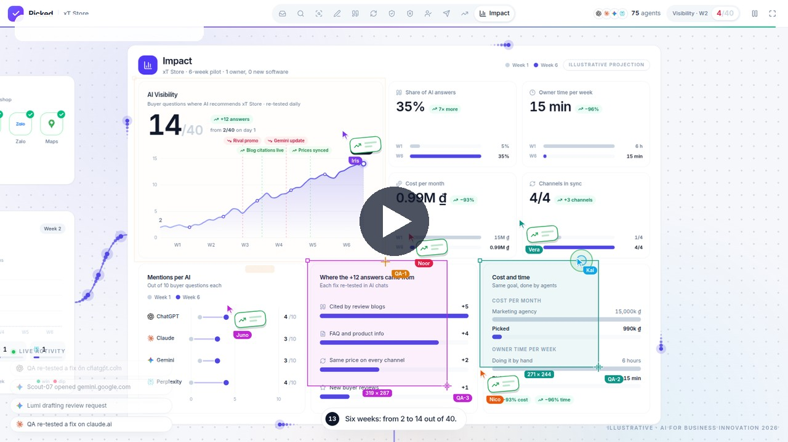

# Picked

**An AI agent team that gets small businesses picked by ChatGPT, Gemini and Claude.**

Customers now ask AI "where should I buy this?". AI names only a few big brands, and small shops disappear from the answer without knowing it. Picked is a team of AI agents that measures this loss, finds why it happens, drafts the fixes, and lets the owner approve them in one tap.

[](https://drive.google.com/file/d/108ArtN2uJnFCOYWFm_qmGGYi6Qu62IH-/view?usp=drive_link)

**[▶ Watch the product demo](https://drive.google.com/file/d/108ArtN2uJnFCOYWFm_qmGGYi6Qu62IH-/view?usp=drive_link)** · **[Live app](https://pickedhq.vercel.app)** · **[Idea video](https://drive.google.com/file/d/1JJtVlpsb54upyW6h2eL2--gJNIoD28x6/view?usp=drive_link)**

---

## What the app shows

The app is one live canvas where a company of agents runs a 96-second loop, from a new shop to a measured result.

| Step | Department | What the agents do |
|---|---|---|
| 1 | Shop | A shop joins with no website needed |
| 2 | Signals | Learn real buyer questions from Zalo and Shopee |
| 3 | Research | Ask 4 AI assistants the same 40 buyer questions |
| 4 | Analysis | Find why AI skips the shop |
| 5 | Content | Write FAQs, product info and review requests |
| 6 | Citations | Pitch the review sites AI trusts |
| 7 | Channel Sync | Make price and hours match on every channel |
| 8 | QA | Re-test every fix in real AI chats |
| 9 | Risk Gate | Block unverifiable claims and hide personal data |
| 10 | Approve | The owner approves in one tap on Zalo |
| 11 | Publish | Fixes go live where AI reads |
| 12 | Track | AI Visibility is measured every week |
| 13 | Impact | Before and after results for the pilot |

The loop runs by itself. Click any AI chat, agent or card to open it. Drag the canvas or use the top bar to jump to a department.

## Run locally

Requires Node.js 22+ and pnpm.

```bash
pnpm install
pnpm dev        # http://localhost:5199
```

Build and preview the production bundle:

```bash
pnpm build
pnpm preview    # http://localhost:5197
```

Open `?t=88` to start the loop at the Impact board, for example `http://localhost:5197/?t=88`.

## Tech stack

- **React 19** with **React Flow** (`@xyflow/react`) for the canvas and edges
- **Vite** and **Tailwind CSS v4** for build and styling
- **Motion** for UI transitions and **zustand** for the simulation clock
- Brand logos from `@lobehub/icons-static-svg` and `simple-icons`
- Hosted on **Vercel**

## Project layout

```
src/
  App.tsx       canvas, camera director, top bar, live feed
  nodes.tsx     department nodes (Research, Analysis, Content, QA, Approval, Publish, Track)
  flows.tsx     Signals, Citations, Channel Sync, Risk Gate, Zalo approval, Impact board
  Swarm.tsx     agent cursor swarm drawn on one canvas overlay
  fx.ts         flow-particle tracks along each edge
  Chat.tsx      miniature ChatGPT, Claude, Gemini and Perplexity windows
  sim.ts        scripted timeline, scores and content
  layout.ts     world coordinates and camera shots
```

## Notes

- **Illustrative demo.** AI answers, shop names and metrics are scripted for the demo. The app does not call any AI API yet. The workflow, screens and approval step are what the MVP shows.
- **Targets, not results.** Before and after figures are pilot targets, not measured results.
- **Next steps.** Connect real AI queries, Zalo and Shopee data, and publishing.

## Team NaN

- **Nguyễn Chí Nhân** — Leader
- **Lê Quốc Anh**
- **Bùi Nguyễn Công Nghiệp**

Built for AI for Business Innovation 2026 (K-Tech College × LIKELION × Cobi Group).
