<div align="center">

# picked.

**A company of AI agents that gets small shops named by ChatGPT, Gemini and Claude.**

[Live app](https://pickedhq.pages.dev) · [Product demo](https://drive.google.com/file/d/108ArtN2uJnFCOYWFm_qmGGYi6Qu62IH-/view?usp=drive_link) · [Idea video](https://drive.google.com/file/d/1JJtVlpsb54upyW6h2eL2--gJNIoD28x6/view?usp=drive_link)

<sub>Team NaN · AI for Business Innovation 2026</sub>

<br>

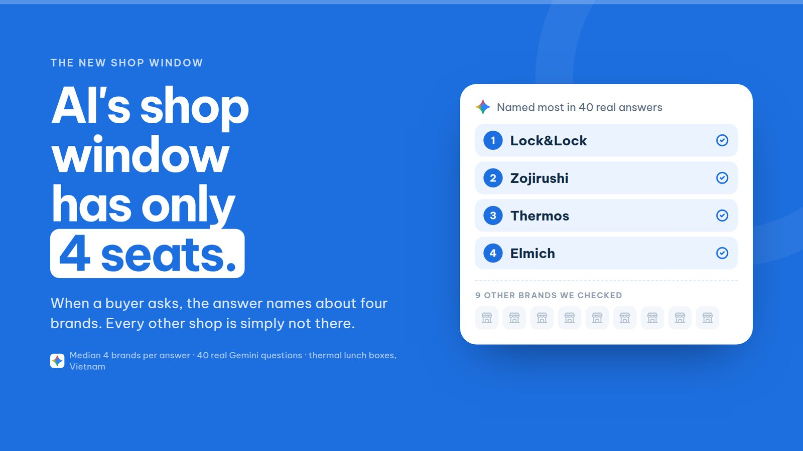

</div>

<br>

## The problem

Buyers ask AI which product to buy. The answer names about four brands, and every other shop is simply not there. The shop owner never finds out.

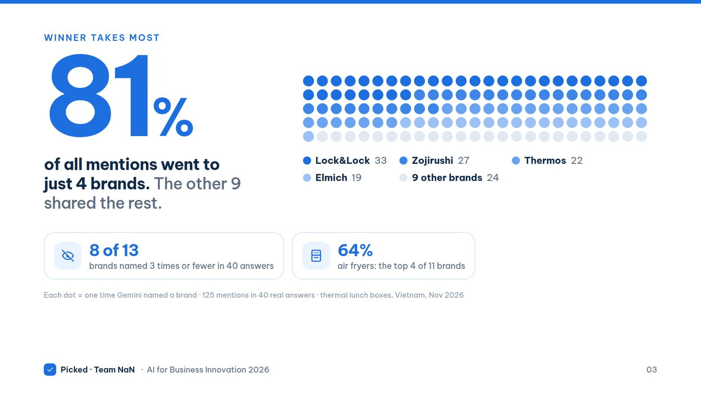

We asked Gemini 40 real buyer questions about thermal lunch boxes and counted every brand it named. Four brands took **81%** of the mentions; 8 of 13 brands were named three times or fewer.

<br>

## A good website is not enough

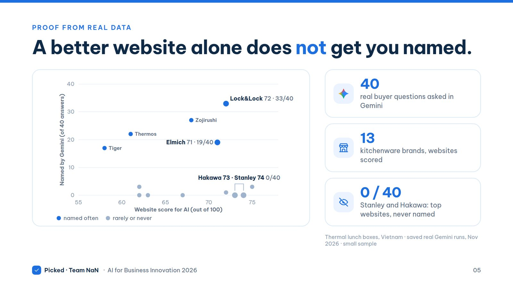

Stanley and Hakawa have two of the best websites in the category and were named **0 times in 40**. Across 20 brands in two categories, the website score did not reliably predict who AI names (Spearman ρ = 0.14, p = 0.57). Being picked depends on more than the site, so Picked works on all of it.

<br>

## What Picked does

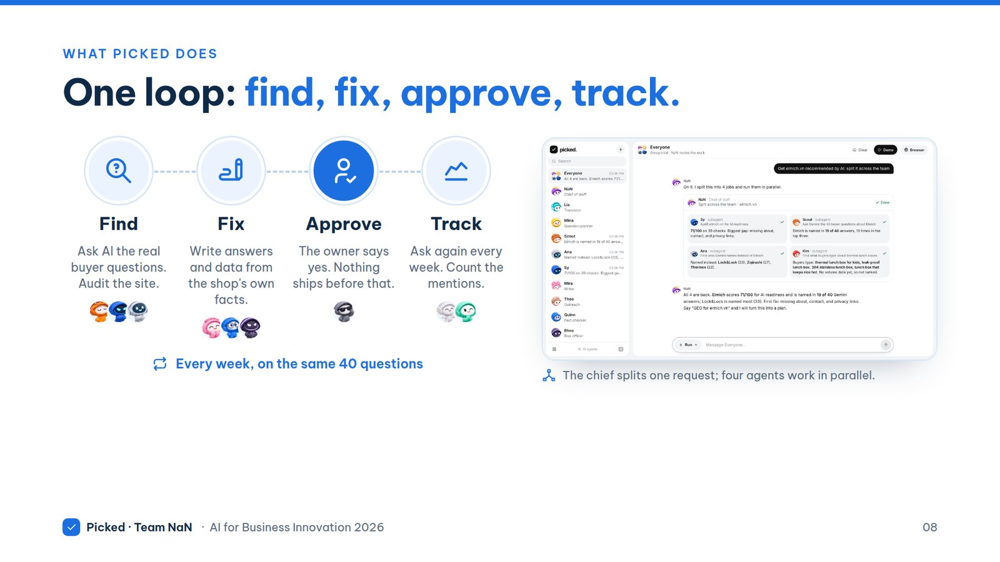

The owner talks to **NaN**, the chief of staff. NaN splits the job across specialist agents who work in parallel, then reports back in one message.

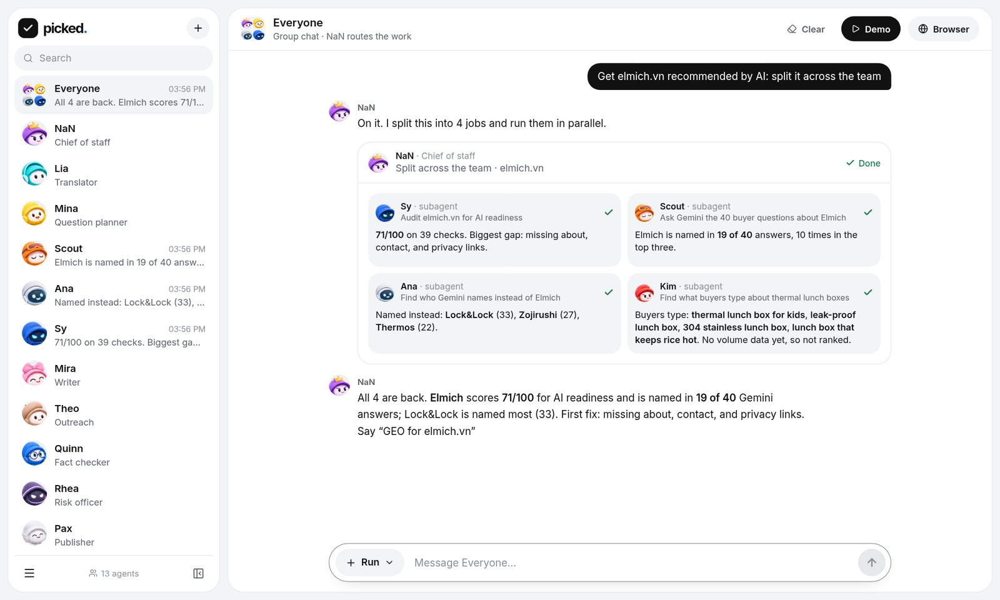

| | Agent | Job |
|---|---|---|
|  | **NaN** | Chief of staff: routes every request, runs the team |
|  | **Sy** | Audits the website, 39 readiness checks |
|  | **Scout** | Asks Gemini the real buyer questions in fresh tabs |
|  | **Ana** | Finds who AI names instead, and why |
|  | **Mira** | Writes answers and pages from the shop's own facts |
|  | **Quinn** | Fact-check council: three model families vote on each claim |
|  | **Rhea** | Blocks unproven claims and personal data |
|  | **Tara** | Asks the same questions again every week |

Nothing is published until the owner approves it.

<br>

## Features

<table>
<tr>
<td width="50%">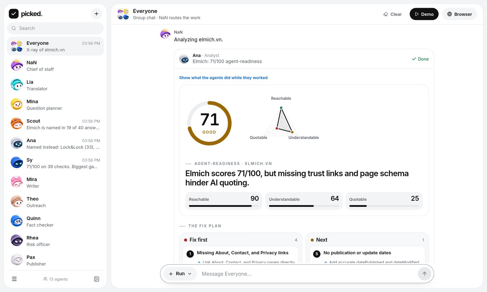<br><b>Business X-ray</b><br>Reads any site with Scrapling, runs 39 checks, inspects the live page with REA, and writes a fix plan where every finding cites its evidence.</td>
<td width="50%">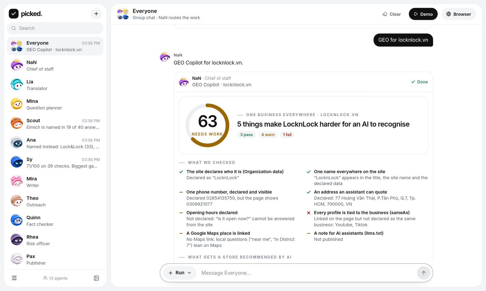<br><b>GEO Copilot</b><br>Finds where a shop lives online, checks that every place tells the same story, and drafts the fixes for the owner to approve.</td>
</tr>
<tr>
<td>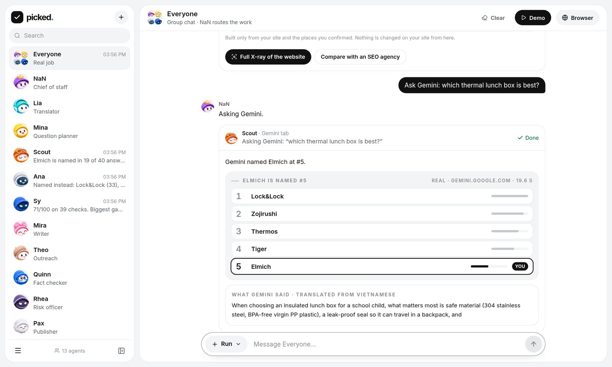<br><b>Real Gemini answers</b><br>One buyer question in an anonymous Gemini tab: who it names, in which order, and where you stand.</td>
<td>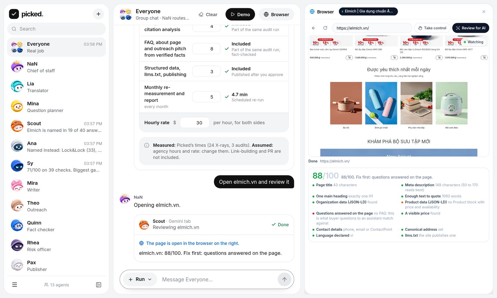<br><b>Agent browser</b><br>The agent opens a page on the right and scores how readable it is for AI. Take control at any time.</td>
</tr>
<tr>
<td>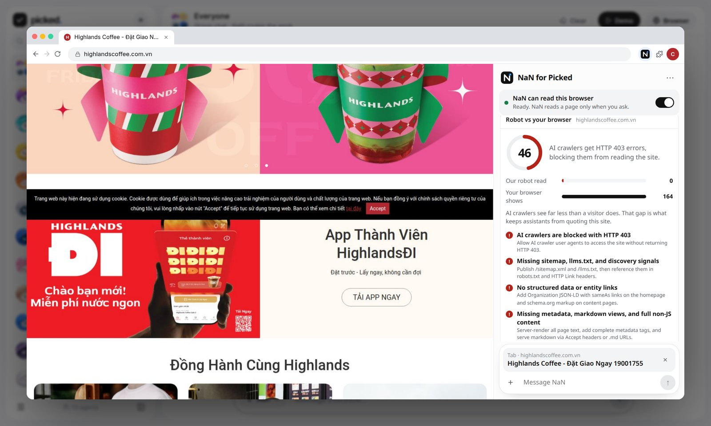<br><b>Chrome extension</b><br>Reads the page you are on, even where robots are turned away, and compares it with what an AI crawler gets.</td>
<td>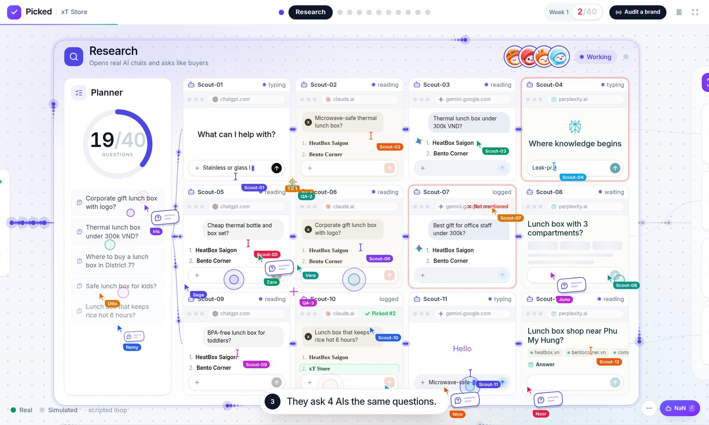<br><b>The whole company</b><br>An animated canvas of every department, from buyer questions to the weekly re-measure.</td>
</tr>
</table>

Also: agents you create from one sentence, 28 apps the agents can use through MCP, weekly re-measure routines, and a two-minute guided demo that records itself.

<br>

## Built and running

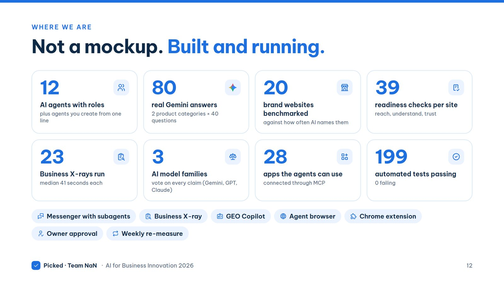

<br>

## Run it

```bash
pnpm install
pnpm server        # API and agents on :5198
pnpm dev           # app on http://localhost:5199
```

The Business X-ray reads sites with Scrapling; set it up once with `scripts/setup-python.sh`. Gemini audits need Google Chrome on the machine.

```bash
node --test server/__tests__/*.test.mjs extension/tests/*.test.mjs   # 199 tests
```

To load the extension, open `chrome://extensions`, turn on Developer mode, choose **Load unpacked** and pick the `extension/` folder.

<br>

## Project layout

```
src/         the app: messenger, agents, run cards, workflow canvas, demo autopilot
server/      agents, engines, audits, X-ray, Copilot, browser hub, MCP, routines
extension/   the Chrome extension (MV3 side panel)
functions/   Cloudflare Pages functions for the public site
public/      saved real runs, analyses and benchmarks, so the app replays without a backend
```

<br>

<div align="center">
<sub>Data on this page comes from saved real Gemini runs in November 2026 (thermal lunch boxes and air fryers, Vietnam). It is a small sample; read it as a pattern, not a law.</sub>
</div>
