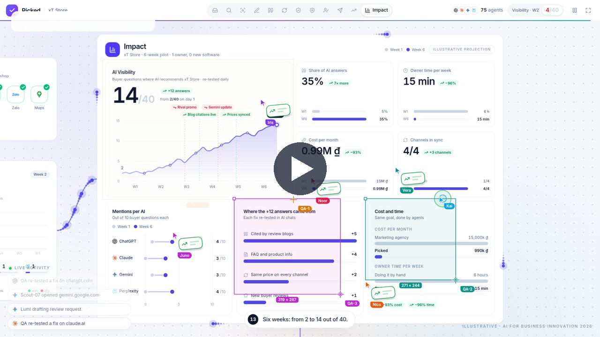

# Picked

**An AI agent team that gets small businesses picked by ChatGPT, Gemini and Claude.**

Customers now ask AI "where should I buy this?". AI names only a few big brands, and small shops disappear from the answer without knowing it. Picked is a team of AI agents that measures this loss, finds why it happens, drafts the fixes, and lets the owner approve them in one tap.

[](https://drive.google.com/file/d/108ArtN2uJnFCOYWFm_qmGGYi6Qu62IH-/view?usp=drive_link)

**[▶ Watch the product demo](https://drive.google.com/file/d/108ArtN2uJnFCOYWFm_qmGGYi6Qu62IH-/view?usp=drive_link)** · **[Live app](https://pickedhq.pages.dev)** · **[Idea video](https://drive.google.com/file/d/1JJtVlpsb54upyW6h2eL2--gJNIoD28x6/view?usp=drive_link)**

---

## What the app shows

The app is one live canvas where a company of agents runs a 96-second loop, from a new shop to a measured result.

| Step | Department | What the agents do |
|---|---|---|
| 1 | Shop | A shop joins with no website needed |
| 2 | Signals | Learn real buyer questions from Zalo and Shopee |
| 3 | Research | Ask 4 AI assistants the same 40 buyer questions |
| 4 | Analysis | Find why AI skips the shop |
| 5 | Content | Write FAQs, product info and review requests |
| 6 | Citations | Pitch the review sites AI trusts |
| 7 | Channel Sync | Make price and hours match on every channel |
| 8 | QA | Re-test every fix in real AI chats |
| 9 | Risk Gate | Block unverifiable claims and hide personal data |
| 10 | Approve | The owner approves in one tap on Zalo |
| 11 | Publish | Fixes go live where AI reads |
| 12 | Track | AI Visibility is measured every week |
| 13 | Impact | Before and after results for the pilot |

The loop runs by itself. Click any AI chat, agent or card to open it. Drag the canvas or use the top bar to jump to a department.

## Live audit with real Gemini tabs

The **Live audit** button in the top bar runs a real audit: it opens several anonymous Gemini tabs in parallel, asks 40 real buyer questions, reads each answer and its cited sources, and scores how often a brand is named and in which position. The canvas shows the real questions, answers and results.

- **Run live** needs the local audit server and Chrome: `pnpm live` (server on :5198, app on :5199). A full 40-question audit takes about 3 minutes on 5 tabs.
- **Replay** plays back a saved real run and re-scores its answers for any brand you type, so it also works online without a server. One real run is bundled in `public/runs/` (category: thermal lunch boxes, 40 questions).
- Everything after the research step (content, QA, approval, publishing, tracking) is still the scripted showcase.

## NaN and stage controls

Press `/` to open **NaN**, the operator chat. Type in any language: the request is translated to English (Google, with Vietnamese accent restoration) and shown as a structured prompt (Role, Context, Task, Constraints, Output).

- Commands run instantly in the browser: `audit Elmich`, `replay Sunhouse`, `hồ sơ Lock&Lock`, `hỏi: hộp cơm giữ nhiệt nào tốt?`, `đến phòng rủi ro`, `duyệt`, `mở shop`, `giải thích`.
- Free-form questions go to the local LLM, which answers from the on-screen data and can trigger the same actions (needs `pnpm live`).
- The **Audit a brand** button (top bar) is three taps: pick a brand, choose **Quick** (about a minute, reuses saved Gemini answers; analysis, content, risk and approval still run for real) or **Fresh** (about four minutes, 40 new questions on real Gemini), press Run. While it runs the top bar shows the current step, a one-tap **Approve** button and Stop; reloading the page rejoins the running audit.
- Each department carries a **Real** or **Simulated** tag while a live or recorded run is on screen.

| Key | Action |
| --- | --- |
| `/` | NaN (operator chat) |
| `←` `→` | Previous or next step |
| `T` | Agent team and handoffs |
| `P` | Presenter notes and timer |
| `I` | Q&A sheet (cost, data, responsibility, what is real) |
| `O` | Whole company |

## Hosting: Cloudflare Pages + this machine as the backend

The UI is on **Cloudflare Pages** (`pickedhq.pages.dev`) and stays up when the backend is off. The backend (`pnpm live`) runs on the team's own machine: it starts a Cloudflare quick tunnel and announces its address to a Pages Function (`functions/`), which proxies `/api`, `/shop` and `/approve` to it. Only that function holds the shared secret, so the tunnel address cannot be used directly; visitors are rate limited per IP.

- Backend on: NaN, live audits and approval QR codes work from the public address.
- Backend off: the UI shows **"NaN-Team đang tạm khóa để phát triển dự án"**; the scripted demo, saved replays and rule commands keep working.
- Publish the UI: `pnpm deploy:edge`. Machine setup: `~/.config/picked/cloudflare.env` (API token) and `edge.env` (shared secret and address); without `edge.env` the server runs local-only.

## Run locally

Requires Node.js 22+ and pnpm.

```bash
pnpm install
pnpm dev        # http://localhost:5199
```

Build and preview the production bundle:

```bash
pnpm build
pnpm preview    # http://localhost:5197
```

Open `?t=88` to start the loop at the Impact board, for example `http://localhost:5197/?t=88`.

## Tech stack

- **React 19** with **React Flow** (`@xyflow/react`) for the canvas and edges
- **Vite** and **Tailwind CSS v4** for build and styling
- **Motion** for UI transitions and **zustand** for the simulation clock
- Brand logos from `@lobehub/icons-static-svg` and `simple-icons`
- Hosted on **Vercel**

## Project layout

```
src/
  App.tsx       canvas, camera director, top bar, live feed
  nodes.tsx     department nodes (Research, Analysis, Content, QA, Approval, Publish, Track)
  flows.tsx     Signals, Citations, Channel Sync, Risk Gate, Zalo approval, Impact board
  Swarm.tsx     agent cursor swarm drawn on one canvas overlay
  live.ts       real audit data (live server or saved run) feeding the canvas
  LiveControl.tsx  the Live audit panel in the top bar
  fx.ts         flow-particle tracks along each edge
  Chat.tsx      miniature ChatGPT, Claude, Gemini and Perplexity windows
  sim.ts        scripted timeline, scores and content
  layout.ts     world coordinates and camera shots
server/
  index.mjs     audit API (SSE) on :5198
  gemini.mjs    drives anonymous Gemini tabs with Playwright
  audit.mjs     parallel runner, parse.mjs answer parser, questions.mjs buyer questions
```

## Notes

- **Real versus scripted.** The Live audit and its bundled replay use real Gemini answers. Content drafts, QA, approval, publishing and the Impact board are still scripted for the demo, and the before/after figures are pilot targets, not measured results.
- **Targets, not results.** Before and after figures are pilot targets, not measured results.
- **Next steps.** Connect real AI queries, Zalo and Shopee data, and publishing.

## Team NaN

- **Nguyễn Chí Nhân** — Leader
- **Lê Quốc Anh**
- **Bùi Nguyễn Công Nghiệp**

Built for AI for Business Innovation 2026 (K-Tech College × LIKELION × Cobi Group).
